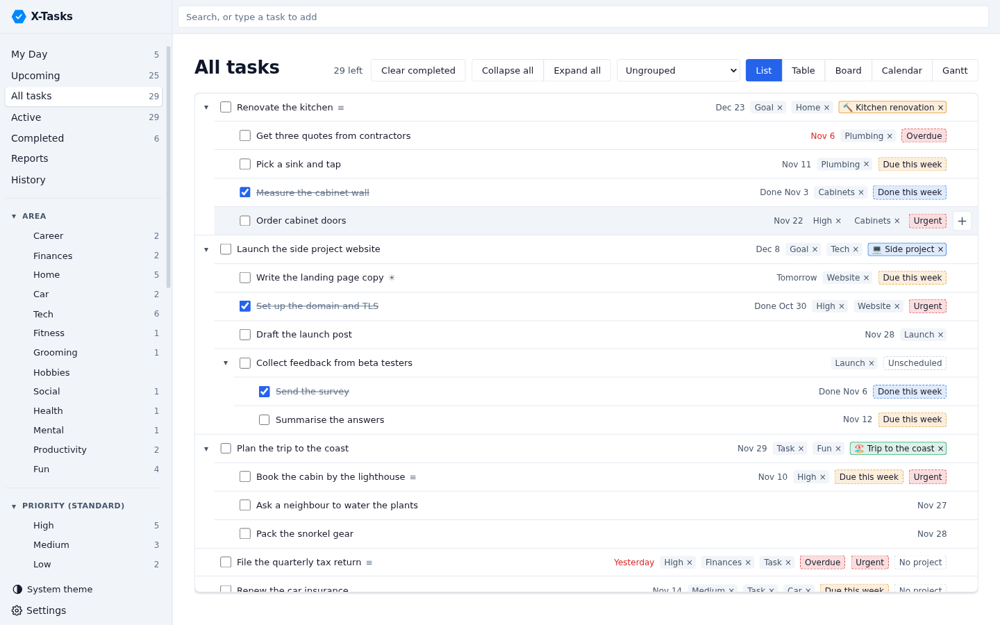
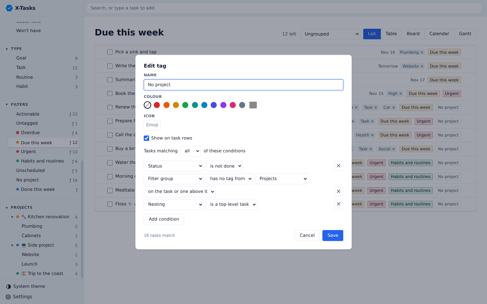
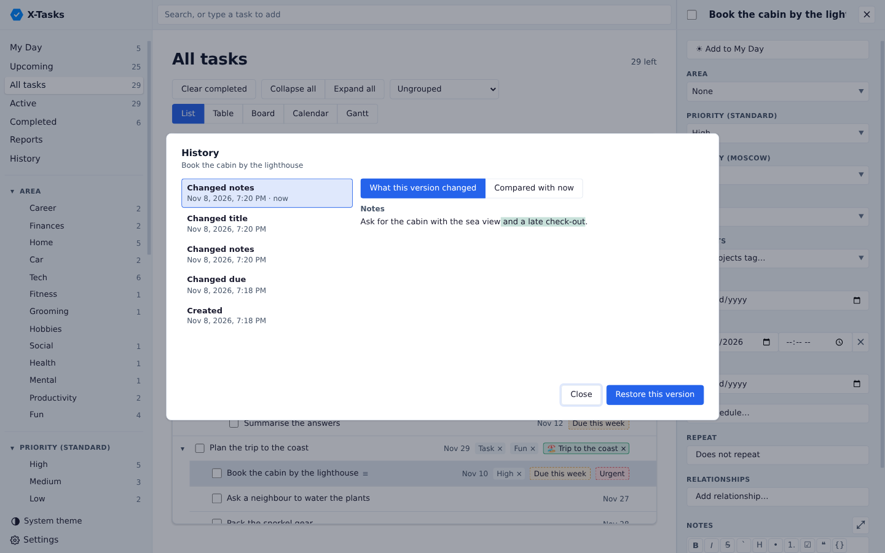
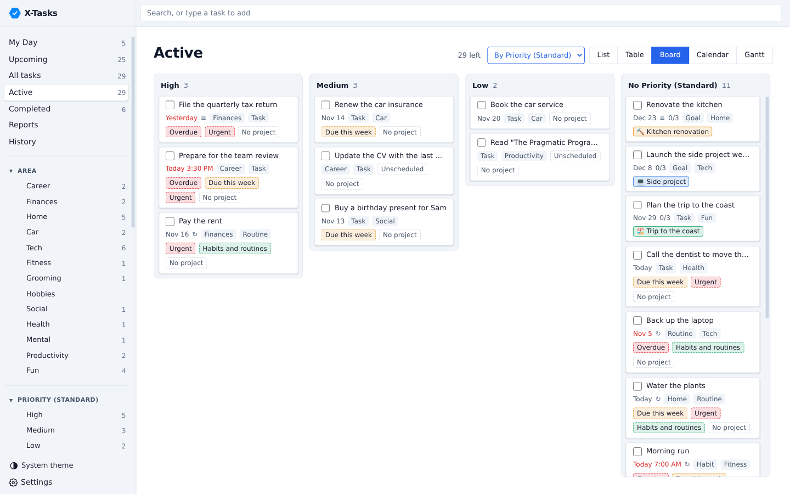
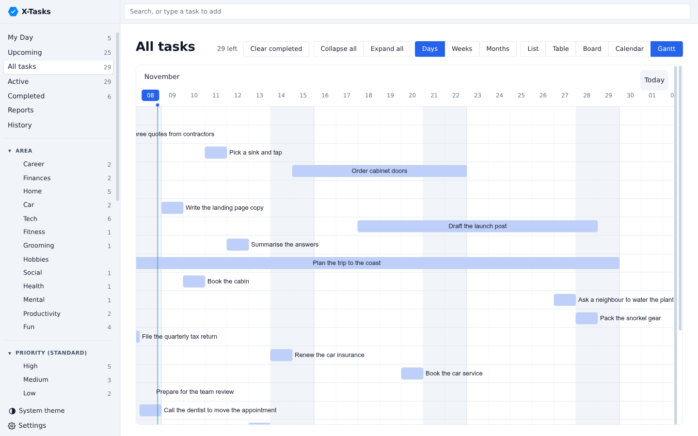
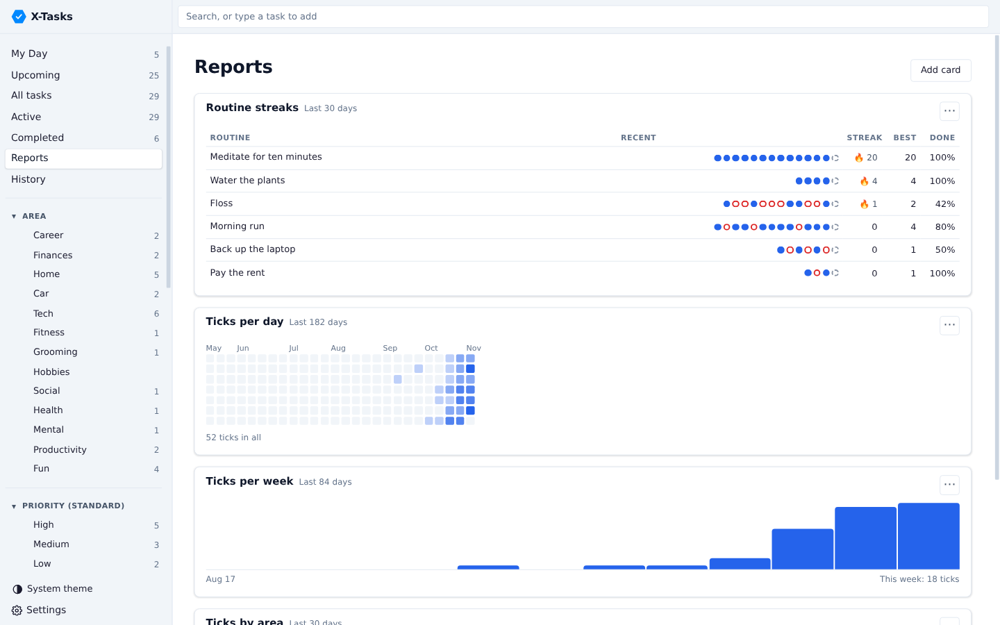
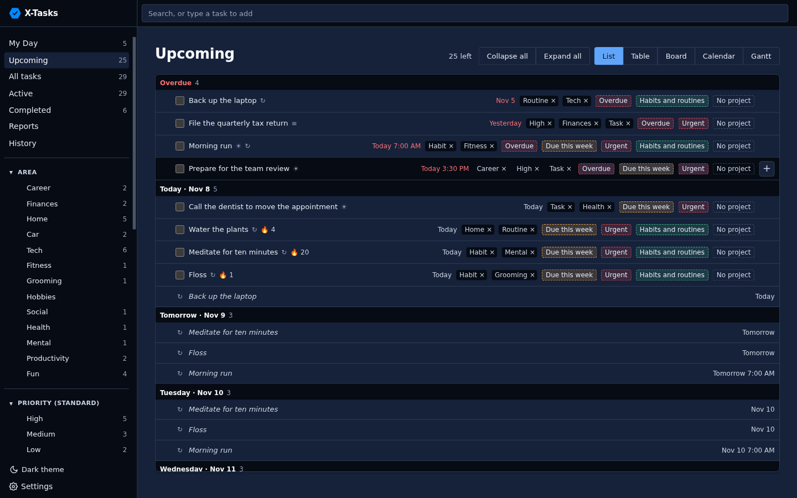

# X-Tasks

A todo manager built with Electron, React and TypeScript, on the shared X-Libs widgets and Halon styles.

Documentation for users and developers: <https://x-tech-laboratories.github.io/X-Tasks/>, built from [`docs/`](docs/).



| Rule tags | Task history |
| :-: | :-: |
|  |  |
| **Board** | **Gantt** |
|  |  |
| **Reports** | **Dark theme** |
|  |  |

The screenshots show the example data from `npm run seed`.

## Development

```sh
nix develop      # node, and an Electron that runs on NixOS
npm install
npm run dev      # hot-reloading dev build
npm run app      # build once and launch
npm run build    # typecheck and production build
nix build        # the packaged app, in ./result/bin/x-tasks
npm run dist     # an AppImage and a Flatpak bundle, in dist/
```

Tasks are stored in an SQLite database at `~/.config/x-tasks/tasks.db` on Linux, using Electron's
built-in `node:sqlite`, together with the choices made on the Settings page. Set `X_TASKS_DB` to use a
different file.

### AppImage and Flatpak

`npm run dist` builds both with electron-builder, set up in `electron-builder.yml`. The Flatpak needs
`flatpak` and `flatpak-builder` on the build machine and the Flathub remote added, from which it installs
the Freedesktop runtime and the Electron base app. The Release workflow builds both on every push to
`main` and attaches them to the same `v1.0.<run>` release as the Android APK.

```sh
flatpak install --user dist/x-tasks-x86_64.flatpak
dist/x-tasks-x86_64.AppImage
```

Both keep their data in `~/.config/x-tasks`, like the Nix package; the Flatpak is given access to that
folder instead of its own sandboxed one, so moving between them keeps the tasks.

### Development database

`npm run dev` and `npm run app` open `dev-data/tasks.db` instead, a database of example tasks, projects,
habits with a few weeks of history, and filters, dated around the day it was made. It is made the
first time either command runs, from `src/dev/seed_database.ts`, and is not kept in git. Electron's own
profile for these runs lives in `dev-data/profile` (set `X_TASKS_USER_DATA` to move it), so they never
touch `~/.config/x-tasks`.

```sh
npm run seed                                     # remake it from scratch, with fresh dates
X_TASKS_DB=/path/to/other.db npm run app         # open another database instead
npm run server -- --database dev-data/tasks.db   # serve it from the web server
```

The seeder refuses to write to `~/.config/x-tasks/tasks.db`. Add new example data to the lists in
the seeder so every checkout gets it.

## MCP server

Turn on **MCP server** in Settings to let AI assistants on this computer read and change tasks. It listens on
`http://127.0.0.1:3917/mcp` by default, as a Streamable HTTP endpoint; the port is set in Settings too.

```sh
claude mcp add --transport http x-tasks http://127.0.0.1:3917/mcp
```

It offers tools to list tasks and tags, add, update, complete, reopen, tag, untag and remove tasks.

### Importing Trilium notes

`scripts/import_trilium_note.mjs` copies Trilium task notes in through this endpoint and Trilium's own
MCP server. Each note becomes a task with its content and every attribute in the notes, its type,
priority and area as tags, its dates and repeat rule, and its checklist and child notes as subtasks.

```sh
TRILIUM_ETAPI_TOKEN=... node scripts/import_trilium_note.mjs             # paste note ids one at a time
TRILIUM_ETAPI_TOKEN=... node scripts/import_trilium_note.mjs --dry-run ID # show the tasks without adding them
```

A note whose title is already on the list is skipped, unless the existing task is empty, which is
filled in instead. `TRILIUM_MCP_URL` and `X_TASKS_MCP_URL` change the endpoints.

## Web server

`x-tasks-server` serves the same app to a browser, from a database of its own, so it can run on a
server and be used from any device. Pages that are open update by themselves when another one
changes something.

```sh
npm run build:server
npm run hash-password -- admin password.hash   # an admin in the accounts file
X_TASKS_PASSWORD_HASH_FILE=password.hash npm run server -- --database ./server-tasks.db --port 3918
nix build .#server   # the packaged server, in ./result/bin/x-tasks-server
```

Browsers sign in with a name and password, the X-Libs accounts every X-app shares. The admins come
from the accounts file `X_TASKS_PASSWORD_HASH_FILE` names; they add other users on the Users page
(`#/users`). Unless "Keep me signed in" is ticked, a session ends when the browser closes; ticked, it
lasts until it is signed out from Your account (`#/account`), where each user also changes their
password, turns on a second factor, sees where they are signed in and makes tokens.

The desktop and Android apps sync by signing in from **Settings → Sync** with the same name and
password; each device gets a token of its own, which Stop syncing gives back. Other programs send a
token made on Your account as an `Authorization: Bearer` header and call `POST /api/<call>` with the
arguments as a JSON array, using the calls listed in `src/shared/web_api.ts`.

On NixOS, import the flake's module and put a TLS reverse proxy in front of it:

```nix
imports = [ x-tasks.nixosModules.default ];
services.x-tasks-server = {
  enable = true;
  passwordHashFile = config.sops.secrets.x-tasks-password-hash.path;
};
```

It keeps its database and backups in `/var/lib/x-tasks-server`. The theme setting has no effect in a
browser, which follows the system theme.

A `view` in the address opens that view instead of the launch view, without changing the saved
one: a built-in view such as `?view=my_day`, `upcoming`, `all`, `active`, `completed` or `reports`,
or tags by name such as `?view=Work,Home`.

### In the Linux sidebar

The [linux-sidebar](https://github.com/BeatLink/linux-sidebar) `web` plugin shows the whole app in a
docked strip: set its address to the server with `?view=my_day`. The page then takes the sidebar's
colours and font from the `--sidebar-*` CSS variables the plugin hands it, and below 700 pixels it
uses the phone layout, where each task's date and tags wrap onto the lines below its title.

## Sync

The desktop app keeps its own database and syncs it with a server, so it works offline and sends
its changes once the server can be reached. Set it up under **Sync** in Settings with the server's
address and token, and choose once whose tasks to keep: the first device sends its own, and later
ones take the server's. Either choice backs up the data it replaces.

Each value a task, tag or setting holds is synced on its own, and the latest edit of it wins, so
editing a task's title on one device and its notes on another keeps both. A subtask added under a
task deleted elsewhere goes too. Window layout, the MCP endpoint and backup settings stay with each
device. The server address and token are kept in `sync.json` beside the database.

Restoring a backup, on a device or the server, stops sync on the devices it affects until someone
chooses again which copy to keep.

## Android

The Android app is the same page inside a Capacitor WebView. It keeps its own database on the
phone, SQLite compiled to WebAssembly and saved in the app's storage after each change, and syncs
with the web server under **Sync** in Settings, as the desktop app does. On a narrow screen the
sidebar becomes a drawer behind the menu button, and a task's details fill the screen.

```sh
nix develop .#android   # node, a JDK and the Android SDK, whose license this shell accepts
npm install
npm run build:android   # builds the page and copies it into android/
cd android && ./gradlew assembleDebug   # android/app/build/outputs/apk/debug/app-debug.apk
```

Install it with `adb install --user 0 -r app/build/outputs/apk/debug/app-debug.apk`. Without
`--user 0`, a Samsung phone also installs it into its Dual Apps profile and shows two icons.

Every push to `main` builds a signed release APK on GitHub Actions and publishes it as the
[latest release](https://github.com/x-tech-laboratories/X-Tasks/releases/latest/download/x-tasks.apk),
numbered by the run so each one installs as an update.
[Add it to Obtainium](https://apps.obtainium.imranr.dev/redirect?r=obtainium://add/https://github.com/x-tech-laboratories/X-Tasks)
to install it and get each new build as an update. The release key is made once, inside
`nix develop .#android`, with `scripts/android-signing-key.sh`. It saves the key and its password
in `~/.local/share/x-tasks/signing` and uploads them as repository secrets. Back that folder up:
Android installs an update only if it carries the same key. A debug build carries a different key,
so it must be uninstalled before a release build will install.

To try the app without a phone, use the emulator shell, which adds an Android 36 emulator:

```sh
nix develop .#android-emulator
x-tasks-emulator &          # starts the emulator; its virtual device lives in ~/.local/share/x-tasks/avd
x-tasks-emulator-install    # builds the app, then installs and opens it on the emulator only
```

`adb -s emulator-5554 reverse tcp:3918 tcp:3918` lets the emulator sync with a local server.

Android only allows https, so the server must sit behind TLS; plain http works only to `localhost`,
for testing through `adb reverse tcp:3918 tcp:3918`. For a server whose certificate comes from a
private or self-signed authority, paste that authority's PEM certificate under **Trusted certificate
authority** in the Sync settings; the app then accepts certificates it signed, and still refuses
expired ones or ones for another host. The phone keeps no backups of its
own; before it takes the server's tasks it saves its old ones in the app's storage.

## Selecting several tasks

Ctrl+click rows to select them, Shift+click to select a range, or Ctrl+A for every row on screen. On a phone,
long-press a row and choose **Select**, then tap more rows. Selected rows turn blue with a bar down their left edge;
the checkbox still only completes a task. A bar at the foot of the window marks them done or not done, reschedules
them, adds them to My Day, tags them or deletes them all at once, and the same actions show on a selected row's
right-click menu. Dragging any selected row moves them all together, keeping their order, onto or beside
another task or onto a sidebar tag. Escape or the ✕ ends the selection.

## Quick add and search syntax

The bar at the top searches as you type. An **Add task** row appears under it, and pressing it, or Down then Enter, adds
what you typed as a task. Enter in the bar opens the first task found, or adds the typed task when nothing matches. The button beside it picks how it reads each, apart:
**Plain** takes the text as typed, **Todoist** (which Planify follows) reads `#tag`, `@label`, `p1`, dates such as
`tomorrow at 5pm` and filters such as `today | overdue`, **GTG** reads `tags:`, `due:`, `start:`, `every:` and
`!today !or !tomorrow`, and **Trilium** reads `#area=Career`, `#dueDate=TODAY+7` and `NOT(#recurrence)`. Each syntax lives
in `src/web/syntax/`, sharing one reader for dates and repeats, and turns a search into one query that every syntax
matches the same way. **Syntax help** in that menu, and the Syntax section of Settings, show examples of each.

## Board, calendar and Gantt

The switch at the top of a view shows its tasks as a list, a table, a board, a calendar or a Gantt chart. The board
puts its columns by the view's grouping, or To do and Done without one, and dragging a card between columns changes
its tag, date or done state. The calendar uses [FullCalendar](https://fullcalendar.io) and the Gantt chart
[Frappe Gantt](https://github.com/frappe/gantt); in both, dragging a task moves its dates and pulling an edge changes
how long it runs. Each view keeps its own layout, or every view shares one, as Settings › Layout chooses.

## Relationships

Add relationship… in a task's details picks a relationship and another task side by side, and the other task shows
the inverse, so "A waits on B" reads "B blocks A" from B. Settings › Relationships names each relationship from both
ends, such as Depends on and Needed by, and says which task depends on the other; that task shows how many open
tasks it waits on and the Gantt chart draws an arrow to it. Filters can test a task's relationships, such as waiting
on an open task, having none, or being linked to one task in particular.

## Task links

**Copy link** in a task's right-click menu copies a link such as `x-tasks://task/<id>`. Opening it from another
program brings the desktop app forward with that task's details open, or starts the app if it is not running. The
Nix package's desktop entry registers the `x-tasks` scheme. Only the app on the default database takes links from
later launches, so a run with `X_TASKS_DB` set never hands its link to another window.

## Layout

- `src/main` — the Electron main process and the task database
- `src/server` — the Fastify web server: `main.ts` starts it, `app.ts` builds the routes, `auth.ts` signs browsers in, `events.ts` tells open pages about changes; it shares the task database code with `src/main`
- `src/main/task_sync.ts` — which tables sync, on the X-Libs `sync_engine`; `src/main/task_sync_client.ts` syncs a device with the server through the X-Libs `sync_client`, and the server answers through `server/sync_routes`
- `src/preload` — the bridge that exposes `window.x_tasks` to the page; in a browser,
  `src/web/web_bridge.ts` sets up the same bridge over HTTP
- `src/web` — the React interface; `src/web/android` holds the Android app's database and bridge
- `android` — the Capacitor Android project
- `src/shared` — types and channel names used by both sides

## License

GPL-3.0-or-later
